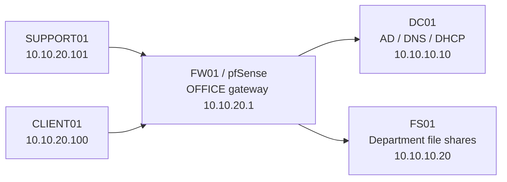
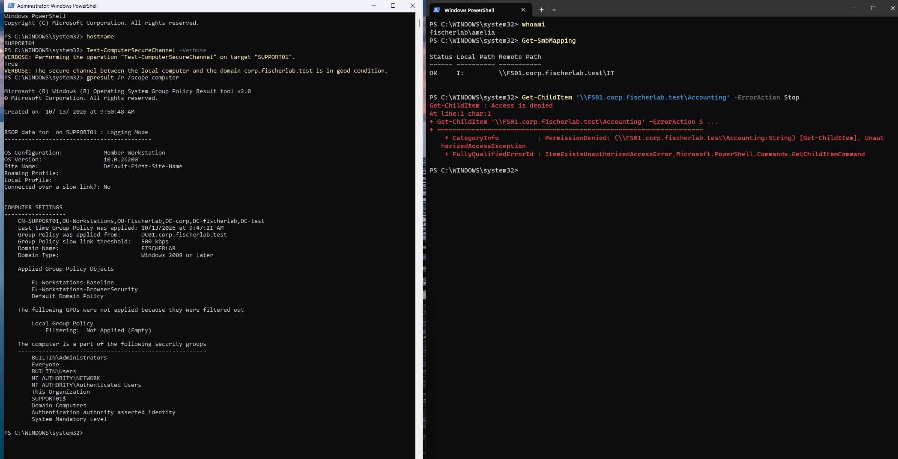
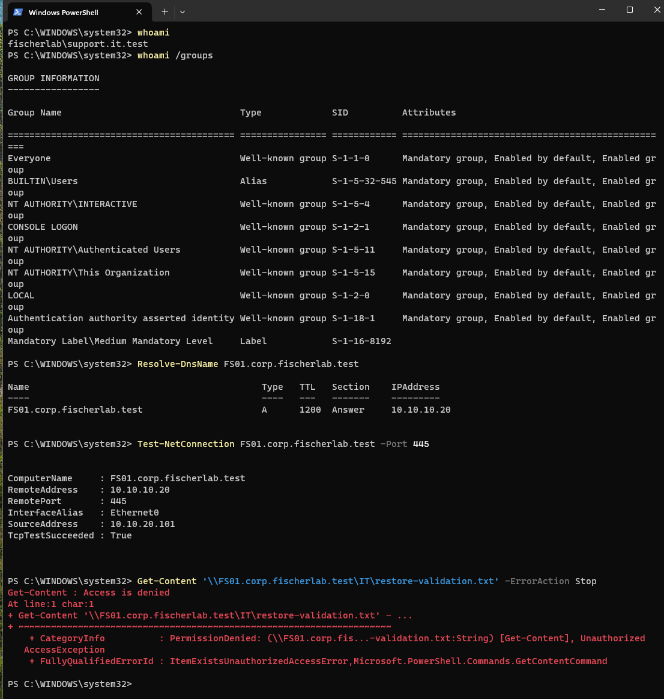
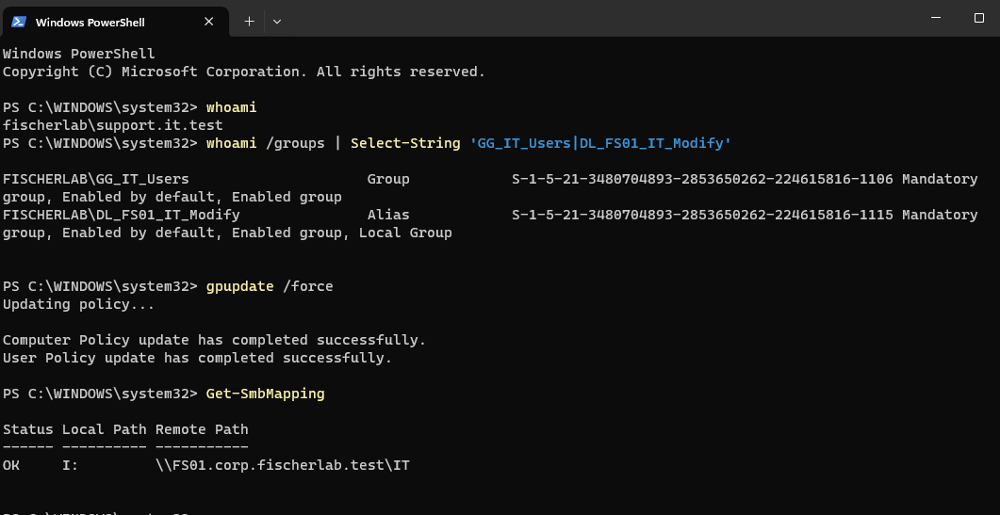
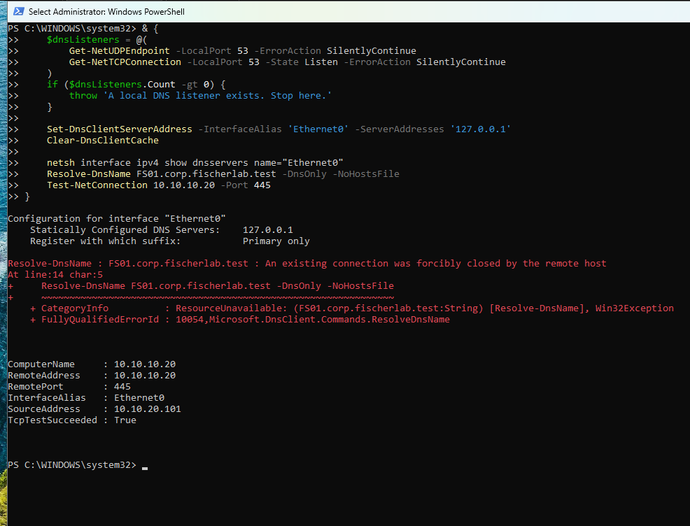
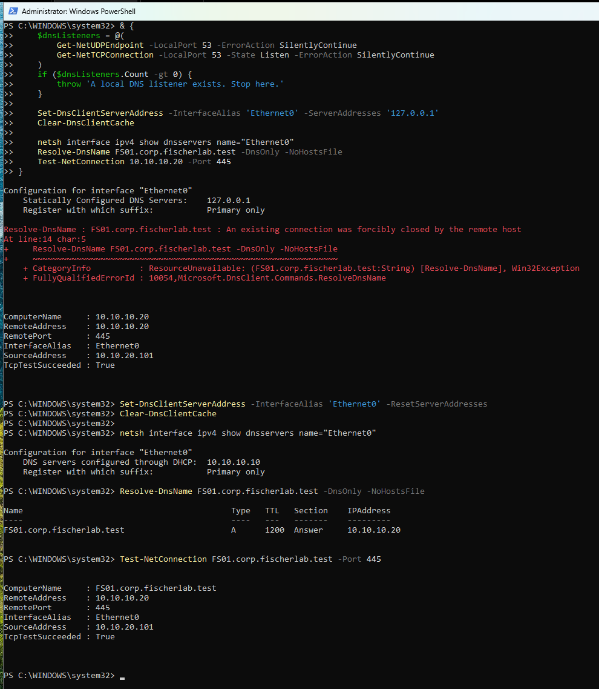
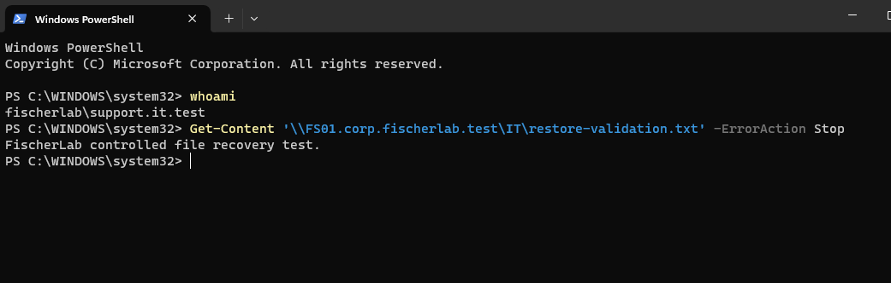

# Windows Support and Endpoint Management Lab

**Three support tickets resolved and verified · October 2026**

Extended my [enterprise infrastructure lab](https://github.com/kfisch94/enterprise-infrastructure-lab) with a dedicated Windows support workstation and practical troubleshooting exercises. Worked through domain onboarding, department file access, and a client DNS failure, documenting the symptoms, investigation, changes, and recovery evidence.

## At a glance

| Ticket | Work performed | Verified outcome |
| --- | --- | --- |
| [SUP-001: Workstation provisioning](tickets/SUP-001-workstation-provisioning.md) | Prepared SUPPORT01, joined the domain, verified OU placement, trust, and Group Policy | Domain sign-in, IT drive mapping and file access worked; Accounting access was denied |
| [SUP-002: Department file access](tickets/SUP-002-department-access.md) | Diagnosed missing group membership by checking connectivity, the user token, group nesting, and share/NTFS permissions | IT access restored; refreshed token and I: mapping verified; Accounting remained restricted |
| [SUP-003: DNS troubleshooting](tickets/SUP-003-dns-troubleshooting.md) | Reproduced a client DNS misconfiguration, compared name resolution with IP connectivity, and restored DHCP DNS | Name resolution, name-based TCP connectivity, and the affected user's file read passed |

These are simulated support requests investigated in a working VMware lab, using synthetic accounts and test files. All three were completed on October 13, 2026.

## Skills demonstrated

- Provisioned a domain workstation and verified its computer object, secure channel, and applied policies.
- Traced department access through user, global group, domain-local resource group, and share/NTFS permissions.
- Distinguished DNS failures, network reachability, and authorization failures using PowerShell diagnostics.
- Restored the original client DNS configuration and repeated the affected user's action.
- Documented each ticket with before/after evidence and clear resolution notes.

## Environment

| Component | Role |
| --- | --- |
| VMware OFFICE network | VMnet3, 10.10.20.0/24 |
| Domain | corp.fischerlab.test / FISCHERLAB |
| SUPPORT01 | Dedicated workstation for the support exercises |
| CLIENT01 | Existing workstation used to establish the healthy baseline |
| DC01 | Directory services, domain DNS, and DHCP |
| FS01 | IT and Accounting shares with department access controls |
| FW01 | Routes the existing OFFICE and SERVERS networks |

## Selected evidence

<strong>Workstation onboarding: domain trust, policies, and department access</strong>

Verified a healthy domain secure channel, applied workstation policies, an IT drive mapping, and the expected Accounting denial.

[Read the provisioning ticket](tickets/SUP-001-workstation-provisioning.md).

<strong>File access: identify the missing membership and verify recovery</strong>

DNS and TCP connectivity worked, but the test account could not read the IT file.

After correcting department membership and refreshing the sign-in session, the expected groups appeared in the token and the IT drive mapped successfully. The ticket also records the successful file read and continued Accounting denial.

[Read the file-access ticket](tickets/SUP-002-department-access.md).

<strong>DNS: reproduce the failure and restore the user's file access</strong>

A deliberate static DNS override caused name resolution to fail while TCP 445 by IP still succeeded.

Restoring DHCP-provided DNS recovered name resolution and name-based connectivity.

The affected test account then read the IT validation file successfully.

[Read the DNS ticket](tickets/SUP-003-dns-troubleshooting.md).

## Documentation and scope

The [ticket write-ups](tickets/) contain the full investigation sequence and links to the [supporting screenshots](evidence/). A successful port test is treated as connectivity evidence; file reads under the affected account establish actual access. GPO application was inspected, but every individual setting was not separately tested. The workstation's exact Windows edition and DHCP address lease were not independently captured; DHCP-provided DNS was explicitly verified.

This repository documents completed local support exercises. Intune and cloud endpoint management are future extensions.

## References

- [Microsoft: Test-ComputerSecureChannel](https://learn.microsoft.com/en-us/powershell/module/microsoft.powershell.management/test-computersecurechannel)
- [Microsoft: Set-DnsClientServerAddress](https://learn.microsoft.com/en-us/powershell/module/dnsclient/set-dnsclientserveraddress)
- [Microsoft: Resolve-DnsName](https://learn.microsoft.com/en-us/powershell/module/dnsclient/resolve-dnsname)
