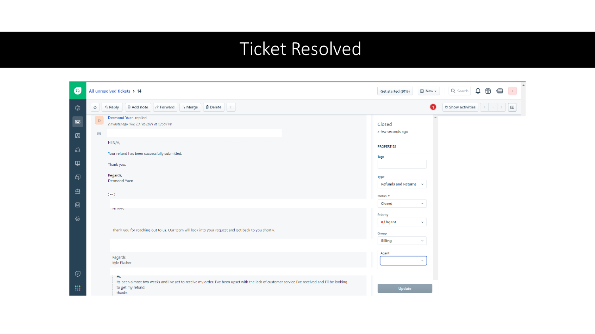
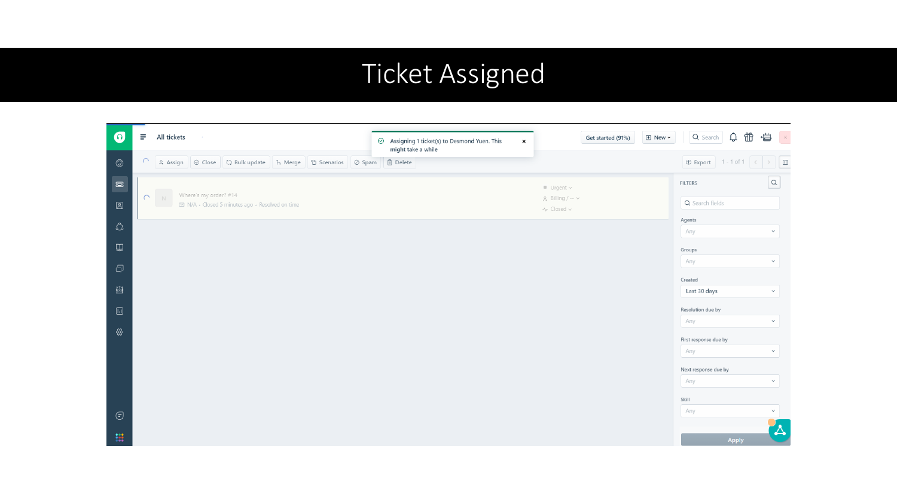
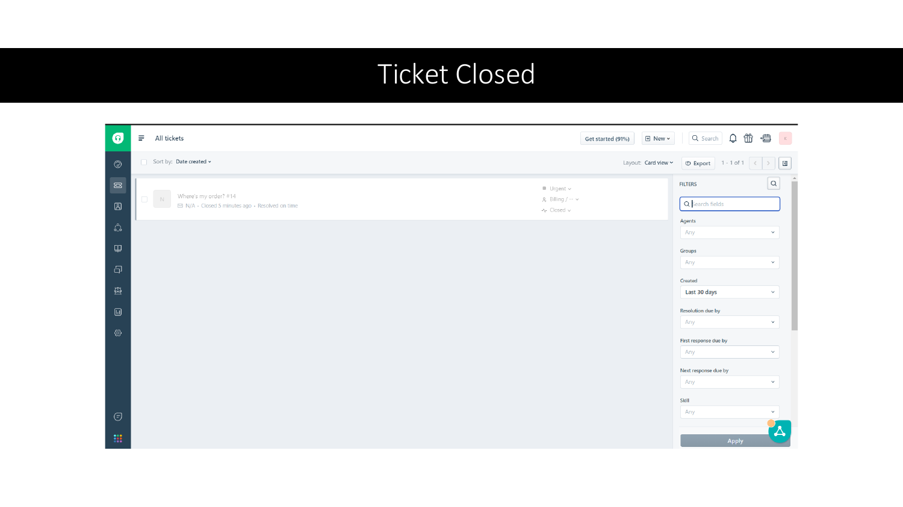

# Ticketing Systems and Service Desk Workflows

**SAIT group coursework | Freshdesk practical exercise and product comparison research**

Worked on a four-person SAIT assignment comparing ticketing systems and demonstrating a support-ticket workflow in Freshdesk. My contribution covered both the comparison research and the Freshdesk setup and ticket-handling exercise.

This is historical coursework, separate from the October 2026 Windows troubleshooting exercises elsewhere in this repository. The screenshots document a classroom customer-service scenario, not a production incident or a live customer refund.

## My contribution

- Researched Freshdesk, Zendesk, and Jira using the comparison sources collected for the assignment.
- Helped evaluate ticketing features, usability, support options, cost, and suitability for different support teams.
- Worked on Freshdesk setup and ticket handling, including customer replies, assignment, and closure.
- Contributed to the group presentation documenting the comparison and practical workflow.

The group presentation credits Spencer Parolin, Beza Ermias, Kyle Fischer, and Desmond Yuen. Individual screenshots include actions from more than one participant; they should not be read as evidence that I performed every displayed action alone.

## Practical scenario

The exercise used an order/refund request to practise acknowledging a request, passing ownership between agents, and recording the outcome. The screenshots show the ticket's category, priority, group, conversation, and closed status.

| Workflow element | What the retained evidence shows |
| --- | --- |
| Customer communication | Acknowledgement and outcome messages in the conversation |
| Assignment | A ticket-assignment action in the agent interface |
| Classification | Type, priority, and group fields in the ticket view |
| Closure | Closed status in the conversation and ticket list |

These captures illustrate workflow elements rather than a complete chronological audit trail. The original slide titled "Ticket Resolved" already shows a Closed status; a separate Resolved-to-Closed transition and SLA timings were not independently captured.

## Selected evidence

Account email addresses and tenant ticket links have been masked in the first image. The public evidence consists of flattened page images; the unedited group PDF is retained privately.

### Ticket conversation and outcome

### Assignment action

### Closed ticket list

## Historical comparison research

The assignment compared Freshdesk with Zendesk and Jira. Its product tables contain review-site ratings, prices, trial terms, and feature labels without consistently identifying the exact edition or plan. I have not reproduced those figures as current product guidance or claimed hands-on administration of Zendesk or Jira from that research alone.

Original research references listed in the presentation:

- [Capterra: Freshdesk and Zendesk comparison](https://www.capterra.com/customer-service-software/compare/124981-174326/Freshdesk-vs-Zendesk)
- [Helpjuice: IT ticketing systems](https://helpjuice.com/blog/it-ticketing-system#zendesk)
- [Capterra: Freshdesk and Jira Service Management comparison](https://www.capterra.com/help-desk-software/compare/124981-138769/Freshdesk-vs-Jira-Service-Management)

## Connection to my current lab

The coursework provided a practical introduction to ticket ownership and communication. My later [Windows support tickets](../tickets/) focus on the technical investigation: symptoms, diagnostic evidence, corrective action, and validation from the affected user's perspective. Together they show both the service-desk workflow and the troubleshooting work recorded in a ticket.
